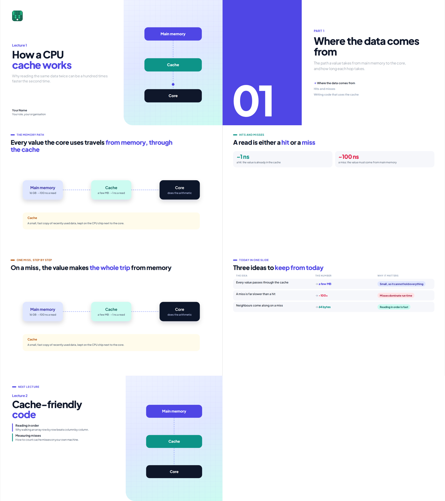

# Slidev lecture template

A clean, light, animated lecture-slide style built with [Slidev](https://sli.dev), plus a guide that shows how to make your own deck in the same style on any topic.

It is the style Dr. Sreedath Panat uses for the Lecture 0 deck of Vizuara's vLLM & SGLang Engineering course: white background, Plus Jakarta Sans, large plain headlines, full-width figures drawn as inline SVG that build up one click at a time, and calm looping motion (dots travelling along arrows) where it helps explain an idea.



## Quick start

```bash
git clone https://github.com/VizuaraAI/slidev-lecture-template.git
cd slidev-lecture-template/starter     # keep the path free of spaces
npm install
npm run dev                            # opens on http://localhost:8781
```

Press the right arrow to step through clicks and `p` for presenter mode with speaker notes. Then replace the topic: edit `slides.md`, and copy `components/FigPipeline.vue` as a starting point for each new figure.

## What is in here

| Path | What it is |
|---|---|
| [`GUIDE.md`](GUIDE.md) | The full how-to: Slidev setup with exact versions, theme tokens and type scale, every animation pattern, how the figures are made, writing rules, low-RAM settings, a self-QA checklist and the starter template explained |
| [`starter/`](starter/) | A small working deck ("How a CPU cache works") with a title slide, section slide, a step-by-step figure with a looping dot, a merged slide, a summary and a closing slide |
| [`reference-theme/`](reference-theme/) | The exact CSS, footer and canvas setup from the original deck, for reference |
| [`skills/slidev-lecture-deck/SKILL.md`](skills/slidev-lecture-deck/SKILL.md) | A skill file for Claude Code (or any coding agent) so it can build decks in this style for you |

## Tools used

- **Slidev 51** (`@slidev/cli` 51.8.2, `@slidev/theme-default` 0.25.0) with Vue 3 single-file components.
- **Figures:** hand-written inline SVG inside Vue components. In practice a coding agent writes most of this SVG from a plain description of the figure.
- **Animation:** Slidev `v-click` with numbered clicks and `$clicks` inside figures, plus plain CSS keyframes (`offset-path` for dots that follow a line).
- **QA:** Playwright, for screenshots, a text-overflow scan and measuring the deck's memory use.
- **Deploy:** `slidev build` and then any static host. The original deck is deployed on Vercel.

No image-generation tools were used for the original deck. `GUIDE.md` section 4 describes an image-based alternative if you prefer generated figures.

## Using it with Claude Code

Copy the skill into your skills folder, then ask for a deck:

```bash
mkdir -p ~/.claude/skills && cp -r skills/slidev-lecture-deck ~/.claude/skills/
```

> "Make a 15-slide lecture deck on how HTTP caching works, in the slidev-lecture-deck style."

## License

MIT. Use it for your own lectures, talks and courses.
